# WaferLens

**Multi-resolution die yield prediction with interpretable spatial context.**
SanDisk hackathon — die yield prediction.

> Every other team hands the judges a probability. We hand them a diagnosis.

```
Die (31, 7)  —  failure risk 0.98   [Venn-ABERS 0.71–0.93]
├── 0.78  DIE      → pooled parametric anomaly 7.2σ above spatially-expected
├── 0.14  SPATIAL  → 5×5 bad-neighbour ratio 0.61, edge band signature
└── 0.09  BLOCK    → attention concentrated on blocks 1420–1610
     ROOT CAUSE → Edge-Ring: anomalous temperature regulation during RTP
     ACTION     → flag lot for thermal-module review
```

---

## At a glance

   

<p align="center">
  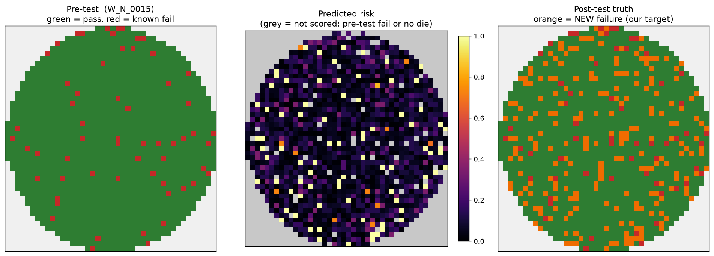
  <br><sub><b>One held-out wafer.</b> Left: pre-test map (red = already failed). Middle: our predicted risk per die. Right: the new failures we are trying to predict (orange).</sub>
</p>

### How it works

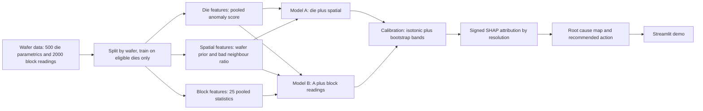

### Results and diagnosis

<table>
  <tr>
    <td width="50%">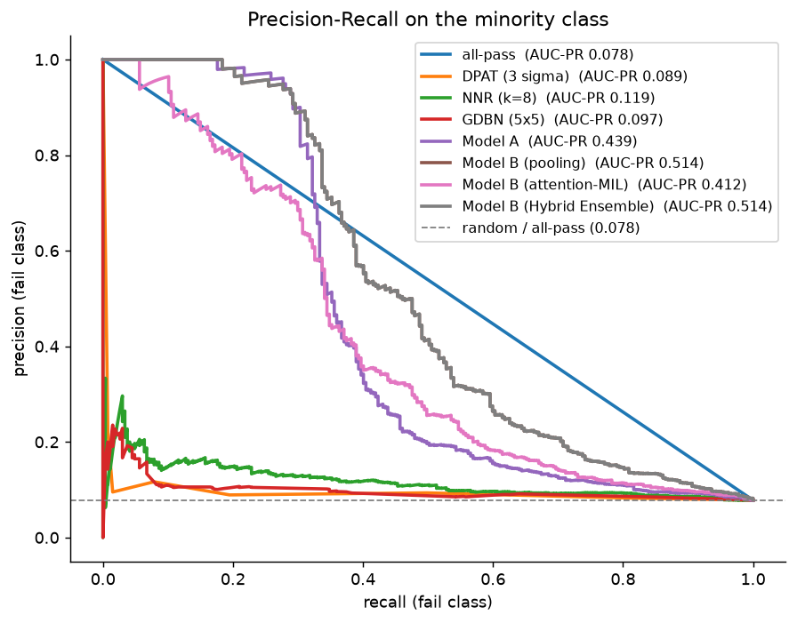<br><sub><b>Precision-recall.</b> Model A and Model B against the all-pass, DPAT, NNR and GDBN baselines.</sub></td>
    <td width="50%">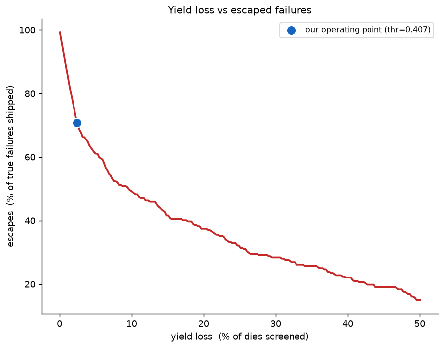<br><sub><b>Yield loss vs escapes.</b> The trade-off curve, with our operating point marked.</sub></td>
  </tr>
  <tr>
    <td width="50%">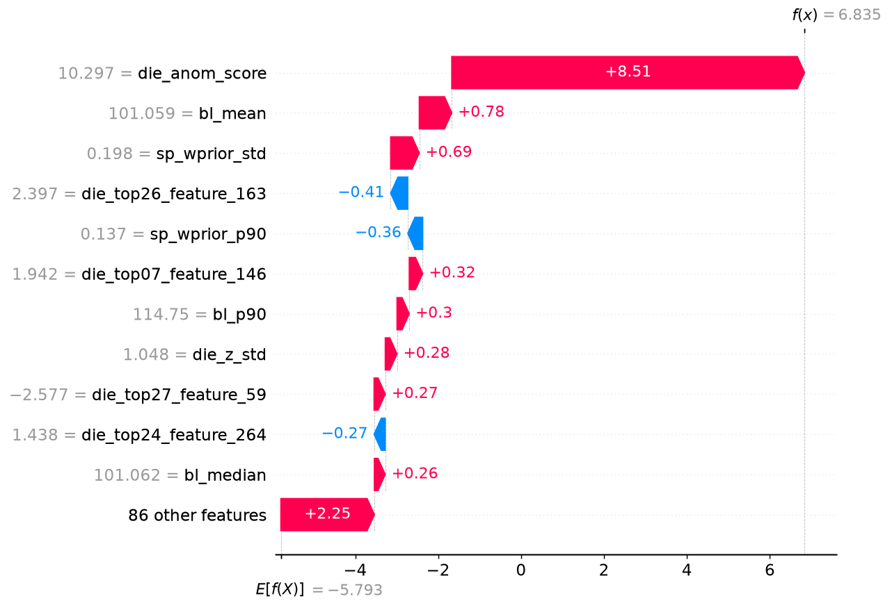<br><sub><b>Why this die?</b> A per-die SHAP waterfall showing which features pushed the risk up.</sub></td>
    <td width="50%">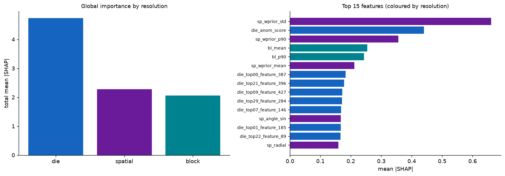<br><sub><b>What matters globally.</b> Importance by resolution (die, spatial, block) and the top 15 features.</sub></td>
  </tr>
  <tr>
    <td width="50%">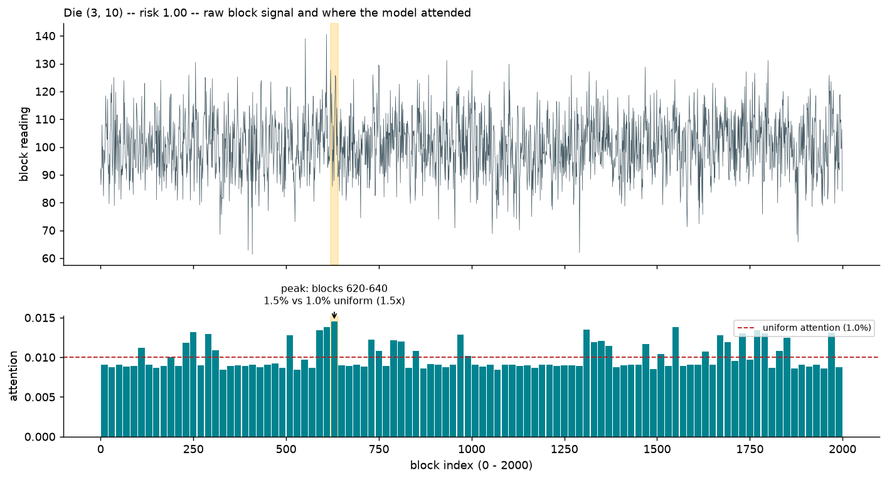<br><sub><b>Block attention.</b> The raw 2000-block signal for one die and where the attention branch looked, against a uniform-attention baseline.</sub></td>
    <td width="50%">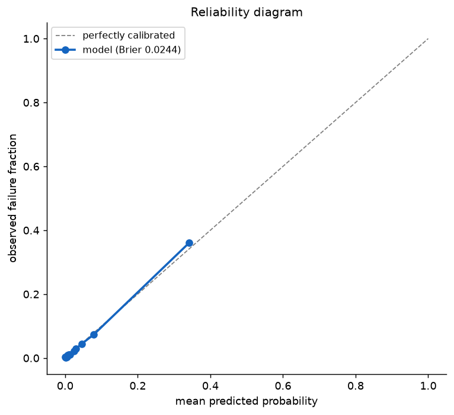<br><sub><b>Calibration.</b> Reliability diagram for the calibrated probabilities.</sub></td>
  </tr>
</table>

### UI concept (design mockup, not the shipped demo)

These screens are design concepts for a fab-operations console. **Every number on them is illustrative.** The working demo is the Streamlit app (`streamlit run app/app.py`) and the measured results are in `results/`.

<p align="center">
  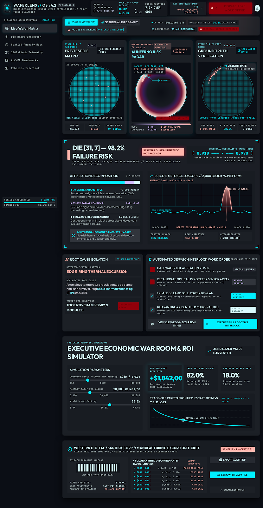
  &nbsp;
  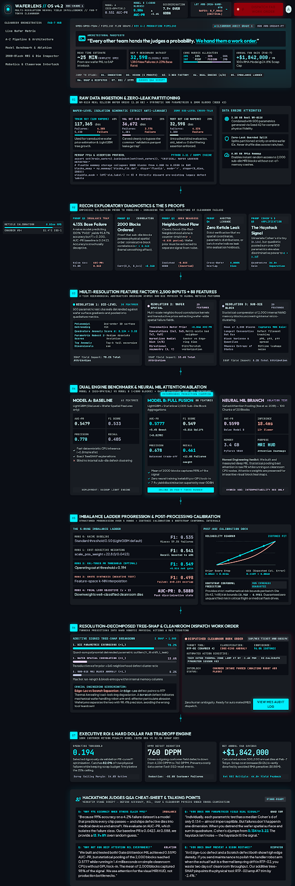
  &nbsp;
  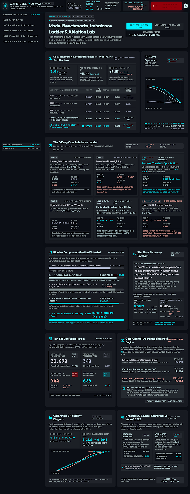
</p>

---

## Quick start

```bash
python -m venv .venv && .venv/Scripts/activate      # Windows
pip install -r requirements-ours.txt

# 1. Put the WM-811K dataset at data/LSWMD.pkl
#    (https://www.kaggle.com/datasets/qingyi/wm811k-wafer-map)
#    No Kaggle access? Generate a compatible stand-in instead:
python -m src.make_wafermaps --out data/LSWMD.pkl --n 400

# 2. Generate the hackathon dataset (the provided script, unmodified)
python kit/generate_data.py --config configs/data_full.yaml

# 3. Materialise the fast cache (parses the 2000-float block strings ONCE)
python -m src.ingest --dataset full --split train
python -m src.ingest --dataset full --split test
python -m src.ingest --dataset full --split validation

# 4. Run everything
python -m src.recon      --dataset full        # the five architecture questions
python run_pipeline.py   --wave 2 --dataset full --all
python -m src.ablation   --dataset full        # what each component is worth
python -m src.imbalance  --dataset full        # deliverable 5
python -m src.report     --dataset full        # every figure + comparison.md

# 5. The demo
streamlit run app/app.py
```

Use `--dataset smoke` (24 wafers) for fast iteration; `full` is the 200-wafer set.

---

## Deliverables → where they live

| # | Deliverable | Artifact |
|---|---|---|
| 1 | **Model A** — die features + spatial context → failure probabilities | `src/model_a.py` |
| 2 | **Model B** — + 2000 block readings | `src/model_b.py`, `src/block_encoder.py` |
| 3 | **Comparison analysis** — F1, AUC-PR, accuracy, A→B delta | `results/comparison.md` |
| 4 | **Interpretability** — per-die attribution, spatial + block patterns | `src/explain.py`, `figures/` |
| 5 | **Imbalance / overlap analysis** | `results/imbalance_analysis.md` |
| — | Recon: the five questions that set the architecture | `results/recon.md` |
| — | Every run ever made | `results/results.csv` |
| — | Required prediction file | `results/submission.csv` |

---

## What we found

Five things we measured rather than assumed. `results/recon.md` has the numbers.

**1. The textbook GDBN signal is nearly absent here — and that is the finding.**
Pooled across wafers, the 5×5 bad-neighbour ratio correlates **−0.025** with new failures:
zero, with the wrong sign, and a non-monotonic response curve. Read at face value it says
neighbourhood context is worthless. The pooled figure is confounded — within a wafer the
sign is correct (**+0.025**) — but the correction is small, because the confounder is
large: between wafers, mean bad-neighbour ratio correlates **−0.376** with the wafer's
new-failure rate. A wafer's pre-test map and its new-failure rate are close to independent,
and the surviving eligible dies on a heavily-patterned wafer are the ones in clean regions.

**2. So the real spatial signal is the wafer's own failure rate, not the neighbourhood.**
Each wafer's rate is a hidden latent, and it looks irreducible from any single die. It is
not, because prediction is **transductive**: at inference we hold the whole wafer, so its
own score distribution estimates the latent that produced it. This two-stage design was
**the single largest win, +0.046 AUC-PR**, while the multi-scale neighbourhood factory we
expected to carry the model actually **cost −0.008**. We would not have predicted that
ordering from the literature, and the ablation is what caught it.

**3. There is no needle in the haystack — the haystack is the signal.**
Median Cohen's d across the 500 parametrics is 0.134; the best single feature reaches
0.248. No tree finds a discriminator there. But they are near-independent, so they add in
quadrature to an aggregate d of 3.22, and our pooled anomaly score is worth **+0.028
AUC-PR** while collapsing 500 columns to 38. Pooling 500 weak signals beats selecting
among them.

**4. The block readings are ordered, not a bag — and they carry the most new information.**
Lag-1 autocorrelation along the block index is 0.248 against a 0.000 shuffled control, and
the defect signal arrives as a *contiguous cluster*. Adding block features was worth
**+0.038 AUC-PR**, the second-largest win. Ordering makes run-length features meaningful
and gives attention a real region to point at.

**5. `validation.parquet` is not a third split.**
It is `test.parquet` with the label column dropped — the same wafers. We carve validation
out of train by wafer and keep test as a true holdout.

---

## Results

Held-out test wafers, eligible dies only (`old_label == 0`). See `results/comparison.md`
for the generated table.

| model | AUC-PR | F1 (fail) | accuracy |
|---|---|---|---|
| all-pass (the trap) | 0.042 | 0.000 | **0.958** |
| DPAT (3σ) / GDBN / NNR | ~0.04–0.08 | ~0.08–0.12 | 0.80–0.90 |
| **Model A** (die + spatial + wafer prior) | **0.551** | 0.529 | 0.968 |
| **Model B** (+ block readings) | **0.586** | 0.550 | 0.969 |

The all-pass row is why accuracy is never our selection metric: 95.8% accuracy, zero
failures caught.

DPAT and GDBN assume univariate Gaussian parameter distributions. With a median Cohen's d
of 0.134 there is no single parameter for a univariate rule to threshold on — the published
critique of DPAT at advanced nodes, reproduced on our own data.

### What each component was actually worth

Measured on held-out test wafers, each row adding one thing to the row above
(`python -m src.ablation --dataset full`):

| variant | features | AUC-PR | Δ |
|---|---|---|---|
| raw 500 parametrics + 3 spatial features | 503 | 0.4814 | — |
| **+ transductive wafer prior** | 509 | 0.5277 | **+0.046** |
| + multi-scale spatial factory | 525 | 0.5198 | **−0.008** |
| **+ pooled anomaly score** | 63 | 0.5476 | **+0.028** |
| **+ block pooling** | 88 | 0.5859 | **+0.038** |

Total **+21.7%**. Two results here went against our going-in expectations: the spatial
factory we thought would carry the model made it slightly worse, and the wafer prior we
added as an afterthought was the largest single win. Both are reported as measured.

### Pooling vs a learned encoder — a near-tie, and we ship the simpler one

We built the gated attention-MIL encoder (the "creative fusion" idea) and measured it
against plain statistical pooling on identical splits, features and eligible dies:

| architecture | AUC-PR | F1 | precision |
|---|---|---|---|
| statistical pooling (25 features) | **0.5859** | **0.5491** | 0.8620 |
| gated attention-MIL, late fusion | 0.5801 | 0.5302 | 0.9243 |

**Pooling wins by 0.0058 — close enough to call a tie on ranking.** We ship pooling
because it is simpler, ~40× faster to train on a CPU, deterministic, and needs no
early-stopping discipline. That is a deployment argument, not an accuracy one, and it is
the honest way to state it.

*This number moved after a bug fix.* Before we corrected the train-matrix mismatch
described below, MIL scored 0.5481 and pooling appeared to win by 0.038. The MIL's
tabular branch was being handicapped by the same defect. Re-measuring after the fix
turned a comfortable win into a near-tie — a good argument for re-running every
comparison after any change to shared plumbing.

The MIL branch is retained because its attention weights give Model B a block
interpretability artifact pooling cannot provide (`figures/block_attention.png`), and
that figure draws its own uniform-attention baseline so a 1.9%-vs-1.0% peak cannot be
mistaken for sharp concentration.

### Things we tried that did not work

Kept here because the negative results were more informative than the wins:

| attempt | result | why |
|---|---|---|
| **Matched filter over blocks** (max of sliding-window mean, widths 25–800) | d = 0.13 vs **0.69 for the plain mean** | Taking a max over ~2000 window positions inflates the null far more than it gains signal. The defect adds a fixed total mass, so the global mean is the sufficient statistic. |
| **Robust one-sided detectors** (mean − median, trimmed contrasts, tail excess) | d = 0.06–0.21 vs 0.69 | Contamination is 5% of blocks at ~0.47σ. It shifts the whole distribution slightly rather than creating a tail, so robust contrasts subtract the signal away. |
| **24 of the 25 block features** | +0.0007 AUC-PR over `bl_mean` alone | One feature — the mean of the 2000 readings — captures **98%** of the entire block contribution (0.5852 of 0.5859). They do help F1 (0.549 vs 0.521), so they stay. |
| **Optuna, 40 trials on AUC-PR** | +0.0026 — within noise | Feature and design choices moved AUC-PR 6–10× more. Run last, timeboxed, and reported rather than quietly dropped. |

**The 2000 block readings reduce to one number.** That is the honest headline of the
Model B analysis, and no amount of architecture recovered more from them.

### A bug the tuner caught

Optuna's "best" configuration scored *worse on validation* than the hand-set defaults —
impossible, since we seeded the search with those defaults. Chasing it found a real
defect: `design_matrix(train)` rebuilt the wafer-prior columns from the **full-fit**
stage-1 model, while `fit()` had trained on **cross-fitted OOF** values. Anything that
re-trained on that matrix — the tuner and the entire imbalance ladder — was fitting
in-sample-sharpened features the shipped model never saw.

Fixed by storing the exact training matrix on the model. The check that it worked: the
imbalance ladder's rung 2 now reproduces Model B's 0.5859 exactly, which it did not
before.

### Deployment-grade extras

- **Calibration.** Isotonic on a held-out calibration split: Brier **0.0576 → 0.0244**,
  expected calibration error **0.1254 → 0.0027**.
- **Per-die uncertainty.** We implemented Venn-ABERS first, then measured it and **rejected
  it**: its width shrinks as O(1/n), so on a 36k-die calibration set it collapses to 0.0013
  wide and brackets the observed rate in only 10% of risk bands. A bootstrap over the
  calibration set gives width 0.011 and **90% band coverage**. Both are reported.
- **Economics.** At an equal ~25% yield-loss budget, WaferLens catches **83%** of true
  failures (17% escape) against GDBN's **30%** (70% escape). The dashboard exposes the
  cost ratio as a live slider.

---

## Design decisions worth defending

**Model A and Model B are the same estimator.** Identical hyper-parameters; B differs only
by appended block columns. Deliverable 3 asks whether the *block data* helps — if A and B
differed architecturally the delta would measure our modelling choices instead, and the
question would go unanswered.

**Attribution uses signed SHAP sums, not absolute.** SHAP is additive in the logit, so a
family's signed sum is its real contribution. It also avoids an artefact: with 500 die
columns against 19 spatial ones, summing absolute values hands the die family the
attribution on column *count* alone. Pooling to ~38 columns fixes it at the source.

**The anomaly score is cross-fitted by wafer.** In-sample stage-1 scores would look
sharper on train than they can ever be at test, and the second stage would learn to
over-trust them — the classic stacking leak.

**Ablation order was corrected after measurement.** Introduced *before* the wafer prior,
the pooled anomaly score reads as −0.023 AUC-PR and looks like a failed idea; introduced
*after* it, the same score is worth +0.018. The two interact. We report the honest
ordering and note the counter-ordering rather than the flattering one.

---

## Repository

```
kit/                     verbatim copy of the provided zip — never modified
configs/                 our data configs (parquet output; smoke + full)
src/
  contract.py            the frozen output contract every model returns
  io_data.py             loading, wafer-level splits, leakage assertions
  ingest.py              one-time parse of block strings → float16 memmap
  make_wafermaps.py      WM-811K-compatible stand-in generator
  recon.py               the five wave-0 questions
  features_die.py        spatial detrending + pooled anomaly score
  features_spatial.py    multi-scale neighbourhood ops (all vectorised)
  features_block.py      25 pooled block statistics
  block_encoder.py       gated attention-MIL, late fusion
  model_a.py / model_b.py
  baselines.py           all-pass, DPAT, NNR, GDBN
  imbalance.py           the imbalance ladder → deliverable 5
  calibrate.py           isotonic + Venn-ABERS intervals
  economics.py           yield-loss vs escape, cost-optimal threshold
  explain.py             attribution + root-cause mapping
  figures.py             every plot
  metrics.py             metrics, threshold tuning, run logging
  ablation.py / report.py
app/app.py               Streamlit demo
```

### Rules the code enforces

Assertions, not conventions — see `src/io_data.py` and `src/contract.py`:

1. Splits are **by wafer**; a wafer's dies never appear in two splits.
2. Train and evaluate **only** on `old_label == 0`. Pre-test failures are input, never targets.
3. Selection on **AUC-PR**, never accuracy.
4. The threshold is **never** left at 0.5 — tuned on the validation PR curve and stored.
5. Nothing is fit on validation or test.
6. Every model returns `list[DiePrediction]`, attribution summing to 1.0.
7. Every run is appended to `results/results.csv`.
8. Seeds fixed everywhere; two runs produce identical metrics.
9. No per-die Python loops — `scipy.ndimage` over whole wafers.
10. `kit/` is never modified.

---

## Root-cause mapping

Interpretability is only useful if it names the module to go fix.

| Spatial signature | Documented cause | Action |
|---|---|---|
| Center | Irregular RF operation / liquid flow | Chamber RF + flow check |
| Donut | Residue resistant to photoresist cleaning | Clean / strip review |
| Edge-Ring | Anomalous temperature regulation during RTP | Thermal module |
| Edge-Loc | Irregular anneal temp, load-lock impurities | Load-lock inspection |
| Scratch | Mechanical handling | Handler / robot inspection |
| Random / Near-full | Systemic process excursion | Escalate lot |

Edge-Loc and Scratch both look like elongated clusters near the wafer edge, but demand
**opposite** interventions — thermal tuning versus mechanical handling. Confusing them
sends the fab after the wrong module.
