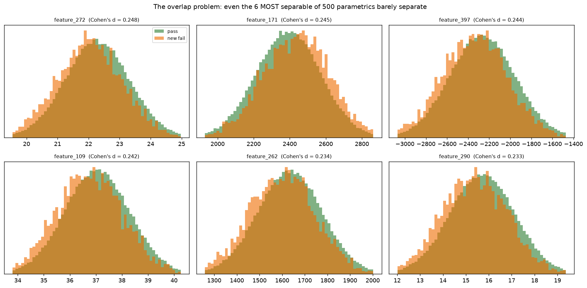

# Imbalance & Overlap Analysis -- deliverable 5

*Auto-generated by `src/imbalance.py` (full dataset, wave 2).
All numbers on held-out test wafers, eligible dies only.*

## The problem, in two numbers

- **Failure rate: 4.23%** of eligible dies newly fail.
  An all-pass model therefore scores **95.8% accuracy** and
  catches nothing. Accuracy is not a metric here; it is a trap.
- **Median Cohen's d across the 500 parametrics: 0.134** (see `recon.md`
  Q5). The rare class is also the *ambiguous* class -- the two problems compound.

## The ladder: measured after every rung

| strategy | auc_pr | f1 | recall | precision | accuracy | threshold |
|---|---|---|---|---|---|---|
| 0. no weighting, threshold=0.5 | 0.5629 | 0.5222 | 0.3572 | 0.9705 | 0.9723 | 0.5000 |
| 1. class_weight=balanced, threshold=0.5 | 0.5651 | 0.4346 | 0.5935 | 0.3428 | 0.9346 | 0.5000 |
| 2. class_weight=balanced + tuned threshold | 0.5651 | 0.5238 | 0.3587 | 0.9706 | 0.9724 | 0.9031 |
| 3. per-wafer adaptive weights + tuned threshold | 0.5518 | 0.5235 | 0.3587 | 0.9687 | 0.9724 | 0.8590 |
| 4. focal loss (gamma=2) + tuned threshold | 0.5687 | 0.5205 | 0.3543 | 0.9800 | 0.9724 | 0.6208 |
| 5. SMOTE oversampling + tuned threshold | 0.5592 | 0.5240 | 0.3565 | 0.9880 | 0.9726 | 0.7716 |

### What actually moved the needle

1. **Threshold tuning is the single biggest lever, and it is free.** Rung 1 -> rung 2 changes no model at all, only where we cut the probability: F1 moves 0.4346 -> 0.5238 at an identical AUC-PR of 0.5651. Ranking quality was never the problem; the default cut point was. This is why CLAUDE.md forbids a 0.5 threshold.
2. **Class weighting trades precision for recall; it does not add information.** Rung 0 -> rung 1 lifts recall 0.357 -> 0.593 but AUC-PR barely moves (0.5629 -> 0.5651). Reaching for `class_weight='balanced'` and stopping there is the common mistake -- it relabels the same ranking.
3. **Per-wafer adaptive weighting did **not** pay off here** (AUC-PR 0.5518 vs 0.5651 for global weighting). We expected it to win, because each wafer's failure rate is an independent exponential draw and one global weight is wrong for nearly every individual wafer. It did not, and we report that rather than quietly dropping the rung. The likely reason is that our transductive wafer-prior features already give the model the per-wafer rate directly, so re-encoding it in the sample weights is redundant.
4. **Focal loss beat tuned global weighting** (AUC-PR 0.5687 vs 0.5651). Focal down-weights easy examples so gradient budget reaches the ambiguous overlap, which is where 65% of this dataset's failures sit by construction.
5. **SMOTE was run last and hurt, as predicted** (AUC-PR 0.5592 vs 0.5651). Synthetic minority points are interpolated between existing failures, and with a median Cohen's d of 0.134 those interpolations land squarely inside the pass distribution. Manufacturing more points inside the overlap cannot resolve the overlap -- it just moves the decision boundary into it.

## Class overlap, visualised

Even the six *most separable* of 500 parametrics show near-total overlap. This is the
direct evidence for pooling: no single feature is a usable discriminator, but 500
near-independent weak ones add in quadrature to something that is.

## PR curves

## Threshold sensitivity -- the operating point is a business decision

Best by AUC-PR: **4. focal loss (gamma=2) + tuned threshold** (0.5687).
Best by fail-class F1: **5. SMOTE oversampling + tuned threshold** (0.5240).

|   threshold_quantile |   threshold |   dies_flagged |   yield_loss_pct |   recall |   precision |     f1 |   escaped_fails |
|---------------------:|------------:|---------------:|-----------------:|---------:|------------:|-------:|----------------:|
|                0.8   |      0.246  |           6520 |             20   |   0.7565 |      0.1601 | 0.2643 |             336 |
|                0.9   |      0.299  |           3260 |             10   |   0.6435 |      0.2724 | 0.3828 |             492 |
|                0.95  |      0.3611 |           1630 |              5   |   0.5384 |      0.4558 | 0.4937 |             637 |
|                0.97  |      0.4191 |            978 |              3   |   0.458  |      0.6462 | 0.536  |             748 |
|                0.98  |      0.4893 |            652 |              2   |   0.4029 |      0.8528 | 0.5472 |             824 |
|                0.99  |      0.8524 |            326 |              1   |   0.2362 |      1      | 0.3822 |            1054 |
|                0.995 |      0.8824 |            163 |              0.5 |   0.1181 |      1      | 0.2113 |            1217 |

The costs are asymmetric: a false accept becomes a field failure and an RMA, while a
false reject is pure yield loss. The table above is the tradeoff a fab actually chooses
from -- and our tuned operating point is one row of it, not a law of nature. Wave 4 turns
this into an explicit yield-loss vs escape curve with a cost slider.

## How each model handles the imbalance

| | Model A | Model B |
|---|---|---|
| Trivial all-pass avoided | yes -- recall 0.357 at the tuned threshold | yes |
| Selection metric | AUC-PR, never accuracy | AUC-PR, never accuracy |
| Threshold | tuned on the validation PR curve, stored, applied unchanged at test | same |
| Overlap strategy | pool 500 weak parametrics into one multivariate score | + block hot-cluster shape |

Naive baseline for contrast: **0. no weighting, threshold=0.5** reached recall 0.357
at accuracy 0.9723 -- high accuracy, few failures caught.
