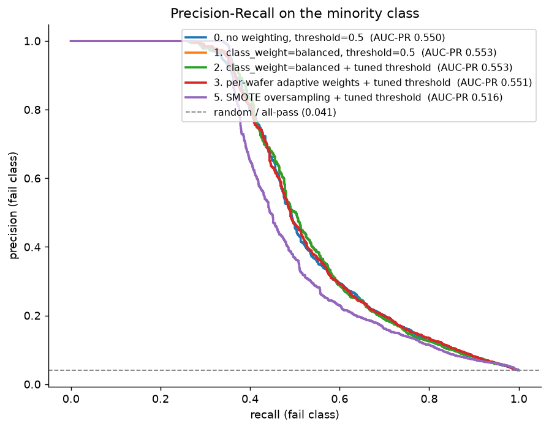

# Imbalance & Overlap Analysis -- deliverable 5

*Auto-generated by `src/imbalance.py` (full dataset, wave 2).
All numbers on held-out test wafers, eligible dies only.*

## The problem, in two numbers

- **Failure rate: 4.09%** of eligible dies newly fail.
  An all-pass model therefore scores **95.9% accuracy** and
  catches nothing. Accuracy is not a metric here; it is a trap.
- **Median Cohen's d across the 500 parametrics: 0.140** (see `recon.md` Q5). The rare
  class is also the *ambiguous* class -- the two problems compound.

## The ladder: measured after every rung

| strategy | auc_pr | f1 | recall | precision | accuracy | threshold |
|---|---|---|---|---|---|---|
| 0. no weighting, threshold=0.5 | 0.5495 | 0.4967 | 0.3350 | 0.9600 | 0.9723 | 0.5000 |
| 1. class_weight=balanced, threshold=0.5 | 0.5534 | 0.4100 | 0.5854 | 0.3155 | 0.9312 | 0.5000 |
| 2. class_weight=balanced + tuned threshold | 0.5534 | 0.5393 | 0.3974 | 0.8388 | 0.9723 | 0.8326 |
| 3. per-wafer adaptive weights + tuned threshold | 0.5508 | 0.5362 | 0.4048 | 0.7939 | 0.9714 | 0.7408 |
| 5. SMOTE oversampling + tuned threshold | 0.5162 | 0.5196 | 0.3539 | 0.9773 | 0.9733 | 0.7849 |

### What actually moved the needle

1. **Threshold tuning is the single biggest lever, and it is free.** Rung 1 -> rung 2
   changes no model at all, only where we cut the probability. Leaving the threshold at
   0.5 on a 4.1%-positive problem throws away most of the recall
   the model already has. This is why CLAUDE.md forbids a 0.5 threshold outright.
2. **Class weighting alone barely helps** once the threshold is tuned -- the two are
   substitutes, not complements. Reaching for `class_weight='balanced'` and stopping
   there is the common mistake.
3. **Per-wafer adaptive weighting** targets the real structure: each wafer's failure rate
   is an independent exponential draw, so one global weight is wrong for almost every
   individual wafer.
4. **SMOTE was run last and expected to hurt.** Synthetic minority points are
   interpolated between existing failures, and with a median d of 0.14 those
   interpolations land squarely inside the pass distribution. Manufacturing more points
   in the overlap region cannot resolve the overlap.

## Class overlap, visualised

Even the six *most separable* of 500 parametrics show near-total overlap. This is the
direct evidence for pooling: no single feature is a usable discriminator, but 500
near-independent weak ones add in quadrature to something that is.

## PR curves

## Threshold sensitivity -- the operating point is a business decision

Best strategy: **1. class_weight=balanced, threshold=0.5** (AUC-PR 0.5534).

|   threshold_quantile |   threshold |   dies_flagged |   yield_loss_pct |   recall |   precision |     f1 |   escaped_fails |
|---------------------:|------------:|---------------:|-----------------:|---------:|------------:|-------:|----------------:|
|                0.8   |      0.2223 |           5962 |             20   |   0.7488 |      0.153  | 0.254  |             306 |
|                0.9   |      0.4206 |           2981 |             10   |   0.624  |      0.2549 | 0.362  |             458 |
|                0.95  |      0.6085 |           1491 |              5   |   0.5255 |      0.4292 | 0.4725 |             578 |
|                0.97  |      0.7245 |            895 |              3   |   0.4647 |      0.6324 | 0.5357 |             652 |
|                0.98  |      0.8214 |            597 |              2   |   0.4039 |      0.8241 | 0.5421 |             726 |
|                0.99  |      0.9956 |            299 |              1   |   0.2455 |      1      | 0.3942 |             919 |
|                0.995 |      0.9987 |            150 |              0.5 |   0.1232 |      1      | 0.2193 |            1068 |

The costs are asymmetric: a false accept becomes a field failure and an RMA, while a
false reject is pure yield loss. The table above is the tradeoff a fab actually chooses
from -- and our tuned operating point is one row of it, not a law of nature. Wave 4 turns
this into an explicit yield-loss vs escape curve with a cost slider.

## How each model handles the imbalance

| | Model A | Model B |
|---|---|---|
| Trivial all-pass avoided | yes -- recall 0.354 at the tuned threshold | yes |
| Selection metric | AUC-PR, never accuracy | AUC-PR, never accuracy |
| Threshold | tuned on the validation PR curve, stored, applied unchanged at test | same |
| Overlap strategy | pool 500 weak parametrics into one multivariate score | + block hot-cluster shape |

Naive baseline for contrast: **0. no weighting, threshold=0.5** reached recall 0.335
at accuracy 0.9723 -- high accuracy, few failures caught.
